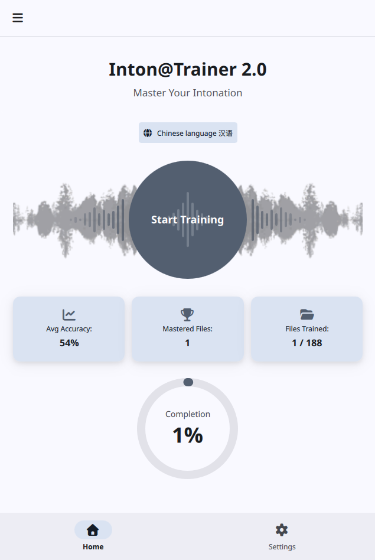
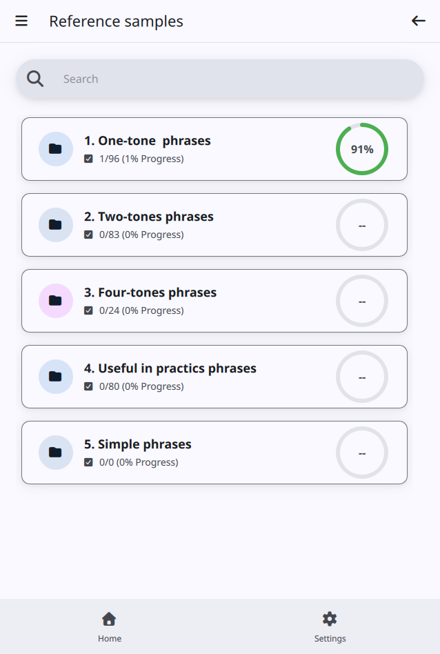
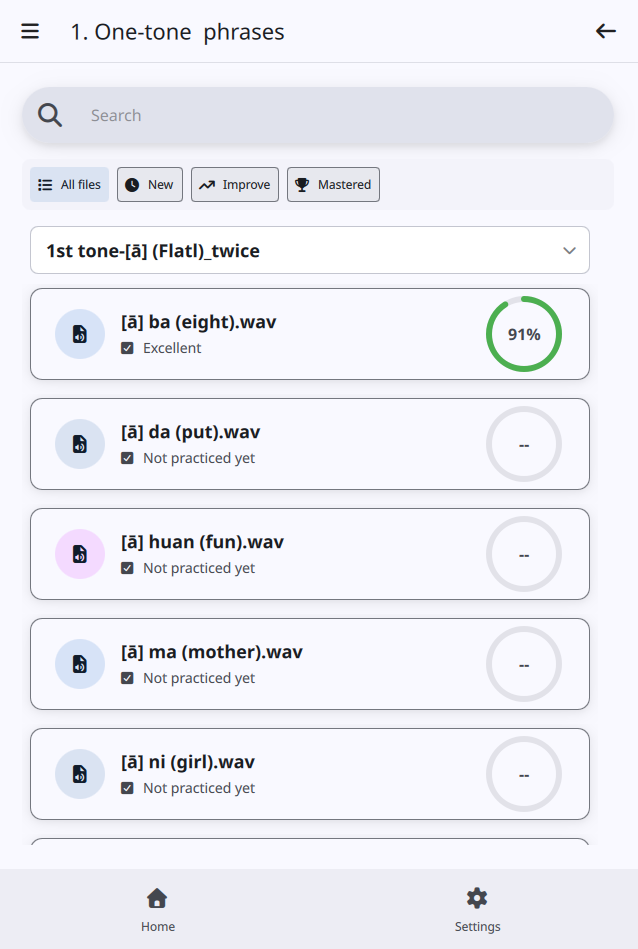
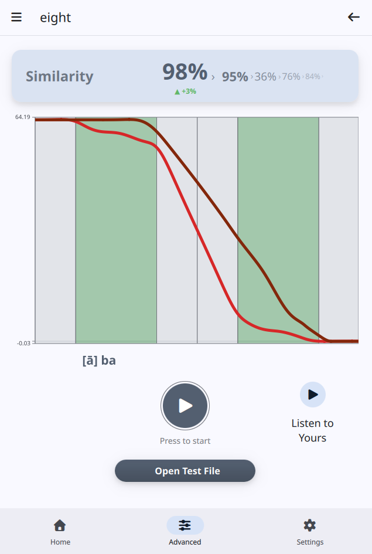
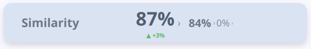

# User Guide — Singing Lessons Trainer

Vladimir Zhitko and Boris Lobanov.

The vocal exercises are presented as audio files recorded by experienced vocal teachers. The proposed set of exercises relies to a large extent on the speech-level singing method developed by the well-known vocal teacher Seth Riggs. Training is based on lip and tongue trills, balancing vowel and consonant sounds, and sliding "sirens".

This guide is for the desktop and Android builds of Singing Lessons Trainer, version 0.1.0. The app is not published on Google Play, and there is no separate download page for it yet.

## 1. What the app does

You listen to a reference sung by a vocal teacher, then sing the same line. The app draws both pitch curves. It scores **melodic similarity** and a **mean tonal error**.

The references are vocal exercises and short song fragments. They are not language-tone drills.

## 2. Lessons

Lessons are installed with the app, under `data/patterns`, in the folders and file names they were recorded with. That includes Cyrillic and Belarusian names. The three top folders are:

- **Singing exercises** — humming and voice warming
- **Some songs examples** — short song fragments
- **Examples of singing** — musical singing and singing techniques

Each lesson the app can open is a WAV file. Some WAV files have a sibling `.sfk` file. That is a Sound Forge peak file kept so the folder matches the original set. The app does not read `.sfk`. It uses the WAV, including cue and label chunks stored inside the WAV when those chunks are present.

On the home screen, **Start Training** opens the folders. Chips filter the list: All, New, Improve (best similarity under 90%), and Mastered (90% or above). Search matches file names. A lesson row shows your best similarity so far.

## 3. A practice take

Three ways to record, chosen in Settings:

- **Automatic.** Recording starts on its own. You sing, then stay quiet. Voice activity detection ends the take, the app scores it, and listening starts again.
- **Guided (Play & Listen).** The app plays the reference, waits a short time, then opens a listen window. If it hears nothing before the timeout, it returns to idle and does not score that wait.
- **Manual.** Auto-stop is off. Tap Record to start and tap again to stop.

**Play Reference** plays the lesson and pauses the recording loop. **Pause / Continue** suspends the automatic loop without leaving the page.

A take that is far from the reference in time alignment can be discarded when a DTW distance limit is set. The bundled settings turn that limit off (`dtwDistanceLimit=0`), so microphone takes are kept.

## 4. The two numbers

**Similarity** is the Pearson correlation of the aligned, normalized pitch curves, as a percent from 0 to 100. A negative correlation is shown as 0. The small arrow under it is the change from your previous similarity. Up to five earlier similarity values sit to the right.

**Error** appears immediately to the right of similarity after a take in the current session. It is the mean tonal error times 100.

On each sample the app takes the absolute difference between the reference curve and your curve. Those are the same aligned samples used for similarity. If **use only nucleus frames** is on, both numbers use only those frames. The differences are averaged as a power mean:

`M_p = (mean of |reference − you| raised to p) raised to 1/p`

The default exponent is **p = 3** (the cube root of the mean of the cubes), so one large miss weighs more than many small ones. The percent on screen is `M_p × 100`. Because the curves are normalized, that percent is of the normalized pitch range, not a count of cents or hertz.

Change `p` with **Tonal Error Power** in the **Error calculation** section of the Settings page. The same value is `tonalErrorPower` in the `[%General]` section of `settings.ini`. Boris Lobanov's exact formula was a picture in his notes, and that picture was lost. This power mean is the calculation in the app until he confirms it.

The graph uses the same colors in the Light and Dark themes: the reference is a wide, light blue line (`#0072B2`), your take is a thin orange line (`#D55E00`), and each nucleus has a gray band. These colors stay distinct for people with color blindness, and the two curves also differ by width. The plot panel is a light background in both themes, so the Dark theme chart stays readable and the curves do not change hue.

Older similarity values stored from previous sessions do not include an error. The error percent appears after you sing in this session.

## 5. Where your data is

Recordings, scores, and settings stay on the device. The Windows build keeps them beside the program. Linux and AppImage builds use a folder named `by.intoncore/SingingLessonsTrainer` next to the program (next to the image file, for an AppImage). Android uses this app's private storage.

You can delete individual records. **Delete user data** in Settings removes your statistics and saved recordings on that device. The privacy notice in the app is the full description. The app does not upload audio.

## 6. Settings worth knowing first

The bundled `settings.ini` is the default set for these lessons (interface language English, title "Singing Lessons", light theme, energy voice detection, pitch range suited to singing). The Settings page can change most of them. The full list is in `docs/settings_guide_ch_ru.md` (Russian) and `docs/settings_guide_en.md` (English).

Leave the advanced pitch, spectrum, and alignment sections alone unless a recording is being cut off or the curves look empty. **Calibrate** listens to the room and sets an energy threshold; stay quiet while it runs.

## 7. If something looks wrong

- No curve for your take: the recording may have been too quiet, too short, or discarded by a distance limit you turned on.
- The lesson list is empty: the WAV files in `data/patterns` did not get copied next to the program. `.sfk` files alone are not lessons.
- The error percent is missing on an old score: sing once in this session. Stored history keeps similarity only.
