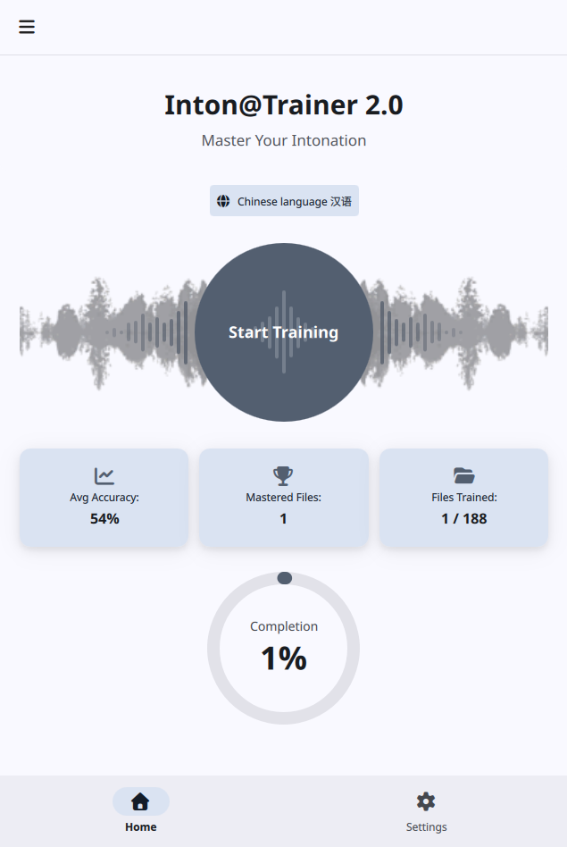
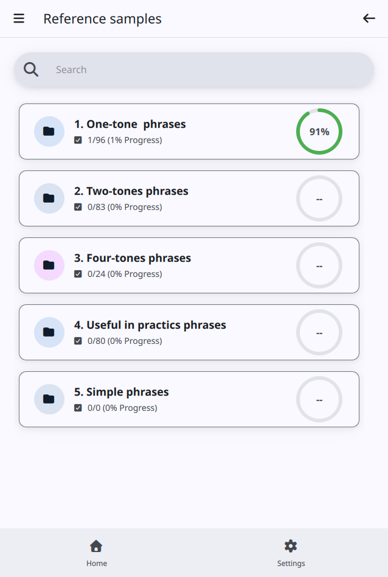
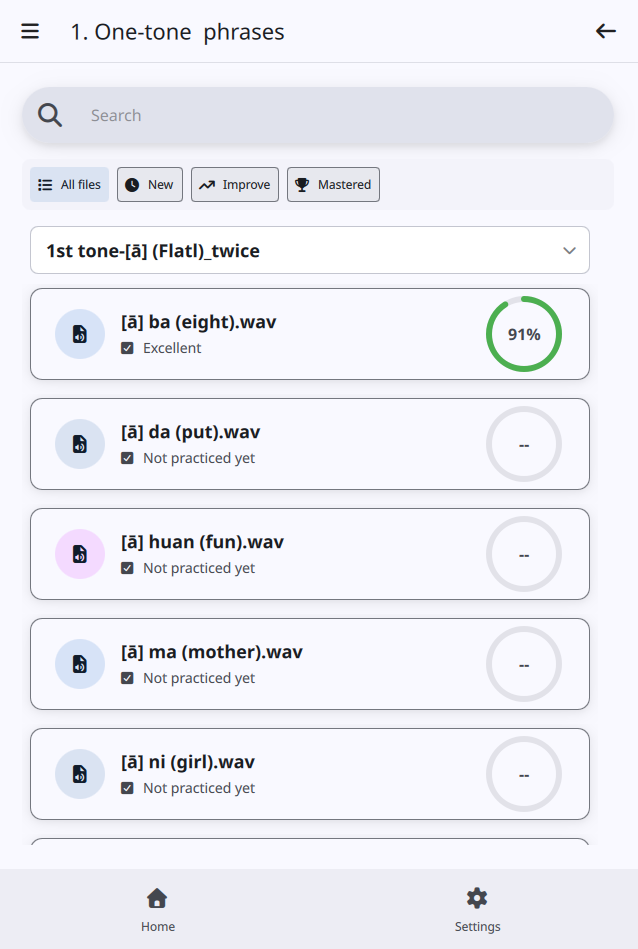
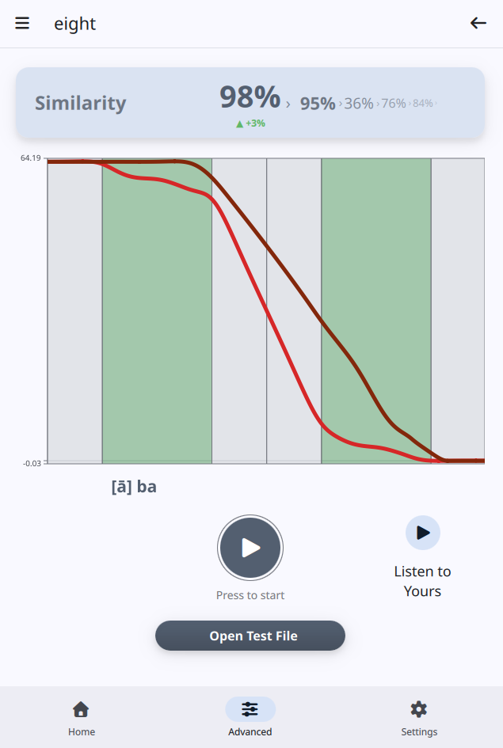
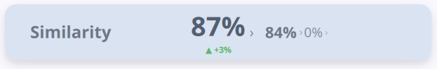

# Руководство пользователя — Singing Lessons Trainer

Владимир Житько и Борис Лобанов.

Вокальные упражнения представлены в виде аудиофайлов, записанных опытными педагогами по вокалу. Предложенный комплекс упражнений в значительной степени опирается на методику пения в речевой позиции, разработанную известным педагогом по вокалу Сетом Риггсом. В основе тренировок лежат упражнения на губные и языковые трели, балансировку гласных и согласных звуков, а также скользящие «сирены».

Это руководство для настольной сборки и сборки Android приложения Singing Lessons Trainer версии 0.1.0. Приложение не опубликовано в Google Play, отдельной страницы загрузки пока нет.

## 1. Что делает приложение

Вы слушаете эталон, спетый педагогом по вокалу, и поёте ту же фразу. Приложение рисует обе кривые тона. Оно считает **сходство мелодии** и **среднюю тональную ошибку**.

Эталоны — это вокальные упражнения и короткие фрагменты песен. Это не тренировка тонов другого языка.

## 2. Занятия

Занятия ставятся вместе с приложением, в `data/patterns`, в тех папках и с теми именами файлов, с которыми они были записаны. Среди имён есть кириллица и белорусский. Три верхние папки:

- **Singing exercises** — распевки и разогрев голоса
- **Some songs examples** — короткие фрагменты песен
- **Examples of singing** — музыкальное пение и приёмы

Занятие, которое приложение может открыть, — это файл WAV. Рядом с некоторыми WAV лежит `.sfk`. Это пиковый файл Sound Forge: он сохранён, чтобы дерево папок совпадало с исходным комплектом. Приложение `.sfk` не читает. Оно использует WAV, в том числе метки cue и подписи внутри WAV, если они там есть.

На главном экране **Начать** открывает папки. Фильтры: все, новые, улучшить (лучшее сходство ниже 90%) и освоенные (90% и выше). Поиск ищет по имени файла. В строке занятия видно лучшее сходство.

## 3. Попытка

Три способа записи, они выбираются в настройках:

- **Автоматический.** Запись начинается сама. Вы поёте и замолкаете. Детектор голоса заканчивает попытку, приложение ставит оценку, и снова слушает.
- **С подсказкой (Play & Listen).** Приложение проигрывает эталон, коротко ждёт и открывает окно прослушивания. Если до таймаута ничего не слышно, оно возвращается в ожидание и эту паузу не оценивает.
- **Ручной.** Автостоп выключен. Нажмите запись, чтобы начать, и ещё раз, чтобы остановить.

**Эталон** проигрывает занятие и ставит цикл записи на паузу. **Пауза / продолжить** останавливает автоматический цикл, не уходя со страницы.

Попытку, которая далеко от эталона по временному выравниванию, можно отбросить, если задан предел расстояния DTW. В поставке этот предел выключен (`dtwDistanceLimit=0`), поэтому микрофонные попытки сохраняются.

## 4. Два числа

**Сходство** — корреляция Пирсона выровненных нормированных кривых тона, в процентах от 0 до 100. Отрицательная корреляция показывается как 0. Маленькая стрелка под числом — изменение относительно предыдущего сходства. Справа до пяти более ранних значений сходства.

**Ошибка** появляется сразу справа от сходства после попытки в текущем сеансе. Это средняя тональная ошибка, умноженная на 100.

На каждом отсчёте берётся модуль разности кривой эталона и вашей кривой. Это те же выровненные отсчёты, что и для сходства. Если включено **только кадры ядра**, оба числа считаются только по ним. Разности усредняются степенным средним:

`M_p = (среднее |эталон − вы| в степени p) в степени 1/p`

Показатель по умолчанию — **p = 3** (кубический корень из среднего кубов), поэтому один крупный промах весит больше, чем много мелких. Процент на экране — `M_p × 100`. Кривые нормированы, поэтому процент относится к нормированному диапазону тона, а не к центам или герцам.

`p` меняется ключом `tonalErrorPower` в секции `[%General]` файла `settings.ini`. Отдельного поля на странице настроек нет. Точная формула Бориса Лобанова была рисунком в его заметках, и этот рисунок утрачен. В приложении стоит это степенное среднее, пока он его не подтвердит.

График использует одни и те же цвета в светлой и тёмной теме: красный эталон (`#d62728`), тёмно-коричневая ваша кривая (`#83270b`) и зелёная полоса ядра. Поле графика светлое в обеих темах, поэтому в тёмной теме график остаётся читаемым и кривые не меняют оттенок.

Старые значения сходства из прошлых сеансов не содержат ошибки. Процент ошибки появляется после того, как вы споёте в этом сеансе.

## 5. Где лежат ваши данные

Записи, оценки и настройки остаются на устройстве. Настольная сборка и AppImage используют папку `by.intoncore/SingingLessonsTrainer` рядом с программой (для AppImage — рядом с файлом образа). Android использует закрытое хранилище этого приложения.

Отдельные записи можно удалить. **Удалить пользовательские данные** в настройках убирает статистику и сохранённые записи на этом устройстве. Полное описание — в уведомлении о конфиденциальности в приложении. Приложение не отправляет звук.

## 6. Настройки, которые полезно знать сразу

Поставляемый `settings.ini` — это набор по умолчанию для этих занятий (язык интерфейса английский, подпись Singing Lessons, светлая тема, энергетический детектор голоса, диапазон тона для пения). Страница настроек меняет большинство из них. Полный список: `docs/settings_guide_ch_ru.md` (по-русски) и `docs/settings_guide_en.md` (по-английски).

Расширенные разделы тона, спектра и выравнивания лучше не трогать, если запись не обрезается и кривые не пустые. **Калибровка** слушает комнату и подбирает порог энергии; во время неё молчите.

## 7. Если что-то выглядит не так

- Нет кривой вашей попытки: запись могла быть слишком тихой, слишком короткой или отброшенной пределом расстояния, который вы включили.
- Список занятий пуст: файлы WAV из `data/patterns` не скопировались рядом с программой. Одни файлы `.sfk` занятиями не являются.
- У старой оценки нет процента ошибки: спойте один раз в этом сеансе. В истории хранится только сходство.
